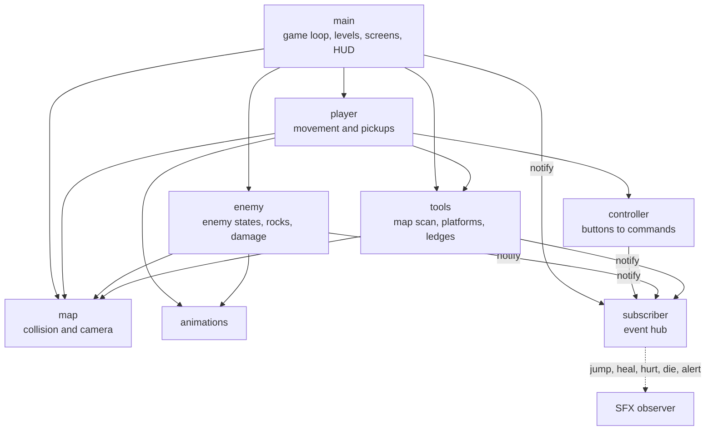
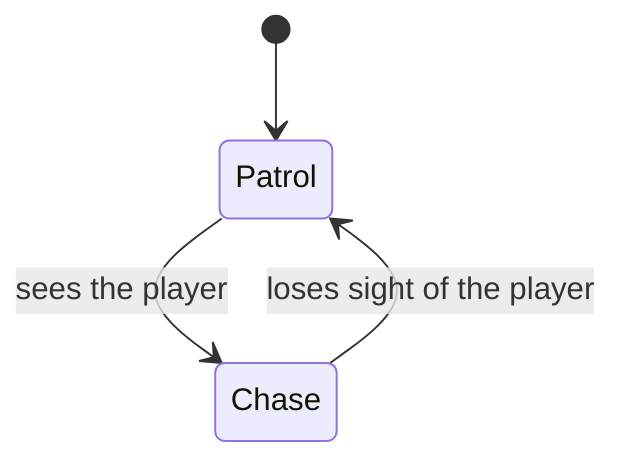

# Tatras

v1.0 · November 2026

My first game: a short three-level PICO-8 platformer where a little fox crosses the Tatra mountains to get back home.

## Play

Tatras is hosted on:

- [itch.io](https://camotedragon.itch.io/tatras)
- [Lexaloffle forum](https://www.lexaloffle.com/bbs/?tid=160526)

## Features

- **Movement:** running and jumping, with a jump buffer (a jump pressed just before landing still counts), and knockback when hit.
- **Levels:** three levels, two side-scrolling and one vertical climb, each with its own palette and music, linked by fade transitions and decorated with drifting clouds.
- **Platforms:** one-way platforms, horizontal and vertical moving platforms that carry you, and crumbling ledges that grow back.
- **Enemies and hazards:** a small enemy that patrols, a large one that spots you by line of sight, charges and shoves you aside, and falling rocks during the final climb.
- **Health:** three hearts lost by halves, heart pickups, two extra lives, and a game over screen.
- **Presentation:** title and ending screens, a camera that follows you and shakes on hits, and a HUD for hearts and lives.
- **Audio:** music I composed for the title, each level, game over and the ending, plus sound effects.

## Architecture

The whole game is one PICO-8 cart, [`tatras-pico-8.p8`](tatras-pico-8.p8), with its Lua code split across nine tabs. Arrows point from a tab to the tabs it calls; only the main connections are shown.



### Design patterns

#### Command

In the `controller` tab, `binds` maps each button to a command function, and `read_plyr_cmds()` returns the commands for this frame's input. The player just runs them, which keeps reading input separate from what each action does.

```lua
binds={
  [0]=cmd_lft,
  [1]=cmd_rght
}

-- player tab
for cmd in all(read_plyr_cmds()) do
  cmd(self)
end
```

#### Observer

The `subscriber` tab is a small event hub: gameplay code calls `actions.notify("jump")` without knowing what happens next. The `SFX observer` tab subscribes to those events and plays the matching sound, so all audio wiring lives in one place.

```lua
actions.sub("jump",on_sfx)

function on_sfx(event)
  local id=sfx_ids[event]
  if id then
    sfx(id)
  end
end
```

#### State

In the `enemy` tab, each enemy holds a current state: a table with an `update` function and optional `enter` and `exit` hooks, which `sm_change` runs on every transition. Entering the chase state, for example, plays the alert sound. Only the large enemy can chase.

```lua
function sm_update(e)
  local next_state=st_patrol
  if e.chase and enemy_vision(e) then
    next_state=st_chase
  end
  sm_change(e,next_state)
  e.sm.current.update(e)
end
```



### Other techniques

- **Data-driven tables:** enemy types live in `enemy_kinds`, keyed by map tile, and animations live in tables like `anims`, where `next` chains into another animation and `once` plays a single time.
- **Spawning from the map:** levels are built in PICO-8's map editor. When a level loads, `scan_map` turns enemy, heart and platform tiles into game objects.

## Future steps

### Refactoring

- [ ] Choose level music from one table and one function; the level-to-track mapping is currently repeated in `load_level` and `fade_lvl_music`.
- [ ] Replace hard-coded sprite numbers (platform tiles, hearts, HUD icons) with named constants.
- [ ] Split `player.update` into smaller functions (input, knockback, platforms, collision, animation) and make its indentation consistent.

### Architecture

- [ ] Replace the `card`, `fade` and `player.fate` flags with one game-state machine built on `sm_change`.
- [ ] Give the player a state machine too; its states already exist as animation names.
- [ ] Move platform state (`ride`, `hold`, `air`) from globals onto the player.
- [ ] Send music through the observer, the way sound effects already are.

## Credits

- [jaular](https://www.lexaloffle.com/bbs/?uid=72395): Taught me the first notions of video game architecture on PICO-8.
- [Lazy Devs](https://www.youtube.com/@LazyDevs) & [SpaceCat](https://www.youtube.com/@spacecat88): Taught me my first lessons to start working on PICO-8.
- [shy](https://www.lexaloffle.com/bbs/?uid=44112): Taught me how to work with animations.
- [Gruber](https://www.youtube.com/@gruber_music): Taught me how to compose music with PICO-8's tracker.
- [Robert Nystrom](https://gameprogrammingpatterns.com/), *Game Programming Patterns*: the Command, Observer and State patterns, and more.

## Disclaimer

The code was written with AI assistance (Cursor). All sprites, maps and music were made by me without AI.

## License

[CC BY-NC-SA 4.0](https://creativecommons.org/licenses/by-nc-sa/4.0/)

See [`LICENSE`](LICENSE) for the full text.